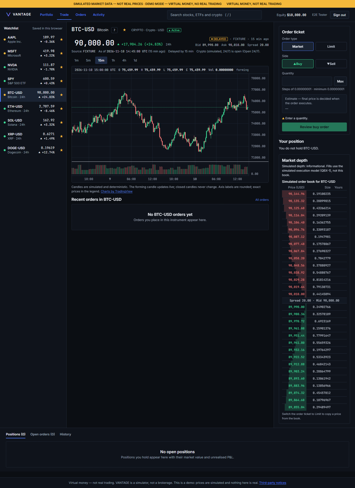
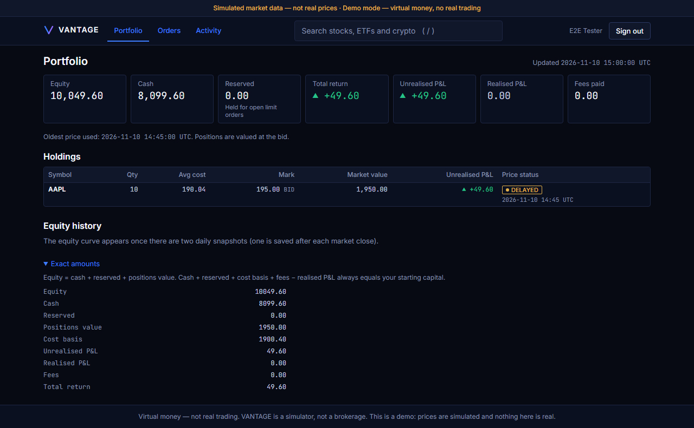
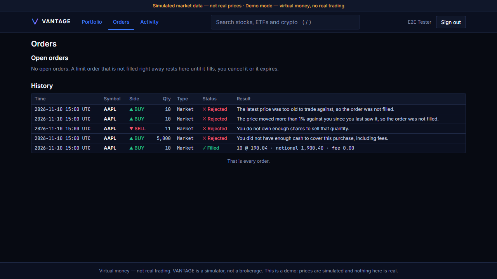
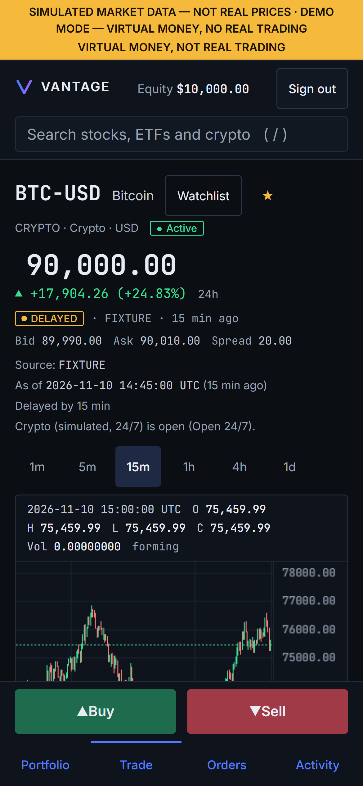

# VANTAGE

VANTAGE is a trading simulator. You start with $10,000 of virtual money and trade stocks, ETFs and crypto at market and limit prices, with a portfolio, an order history, a charting terminal and a phone layout. Behind it is a small but strict backend: an append-only double-entry ledger whose invariants the database itself enforces, exact decimal arithmetic end to end, idempotent order placement and a limit-order matcher.

> **Virtual money, simulated prices. Not a real exchange and not a brokerage.** No real money is involved, no real order is ever placed, and the prices come from a deterministic seeded generator and are labelled SIM everywhere they appear. See [how it works and what is simulated](apps/web/src/app/about/page.tsx) (the `/about` page of the running app) and [docs/FACTS.md](docs/FACTS.md).



| Portfolio                                                                        | Orders                                            | Phone (390 px)                                                      |
| -------------------------------------------------------------------------------- | ------------------------------------------------- | ------------------------------------------------------------------- |
|  |  |  |

The screenshots are the ones committed with the phase reports (M6a, M9a, M9b); they were not regenerated for this page.

## What it does

- **Accounts:** register and sign in with an httpOnly session cookie, a $10,000 virtual grant, and per-address rate limits.
- **Trading:** market and limit orders (DAY and GTC), whole shares for stocks and ETFs, fractional quantities for crypto, a preview before you submit, and cancel with an exact release of the reservation.
- **Limit orders:** cash (a BUY) or shares (a SELL) are reserved when the order is accepted; a background matcher fills them when the simulated quote reaches the price.
- **Portfolio:** cash, reserved cash, positions, cost basis, realised and unrealised profit and loss, fees and an equity figure, all computed on the server as exact decimal strings.
- **Market data:** a deterministic simulated feed (stocks, ETFs and crypto, open around the clock in the demo profile) with freshness states, a candle chart with several intervals, and a simulated depth book that is informational only.
- **Terminal and phone:** a charting terminal with a watchlist, search, an order ticket and Open orders and History panels; a phone layout with a bottom-sheet ticket.
- **Demo mode:** an optional "Try the demo" button that creates a temporary account with a random password, and `pnpm demo:seed` that gives an existing account a small believable history through the real API.

## Why it is interesting

The product is deliberately modest. The engineering underneath it is the point.

- **An append-only double-entry ledger with database-enforced invariants.** Every change to cash or holdings is a set of ledger entries that sums to zero per currency. Triggers refuse updates and deletes of ledger rows, balances are checked by constraints, and a reconciliation function verifies ten invariants (I1 to I10) after tests. See [docs/ledger.md](docs/ledger.md).
- **Exact decimals, no floats.** Money and quantities are decimal strings in the API and integers of 1e-8 in the engine. Lint rules ban float-style arithmetic in the money package, and the browser never does arithmetic on money: it shows strings the server computed.
- **Idempotency end to end.** Every order carries an Idempotency-Key. The same key and body returns the stored result, the same key with a different body is a 422, and a double click places one order. Several unique constraints back it up.
- **Row-lock ordering and concurrency tests.** Every path takes the account row, the cash row, the order row, the position and the lots in the same order. Tests run parallel buys that exceed cash, duplicate keys, and a cancel-versus-fill race over many iterations against a real Postgres. See [the lock diagram](docs/ARCHITECTURE_DIAGRAMS.md).
- **A deterministic engine.** The execution model (QBX-1) is a pure function of the quote, the fee schedule and the state. The same inputs give the same fill to the last digit.
- **Reservations and the matcher.** A resting order holds exactly what it needs, a fill returns the difference, and cancel or expiry releases it. The matcher takes an advisory lock so an accidental second instance only skips ticks.
- **Independent reference-model property tests.** Property tests (fast-check) compare the engine with a separate BigInt implementation written in the test file, so a bug has to be present in two unrelated implementations to pass.
- **Honest simulated data.** Every price carries a source and a freshness state; stale quotes are not used to fill orders; the simulated depth book says on screen that it is informational.

The diagrams are in [docs/ARCHITECTURE_DIAGRAMS.md](docs/ARCHITECTURE_DIAGRAMS.md): the system, the order lifecycle, a limit BUY from reserve to fill, the ledger accounts, and the lock order. The numbers in them are checked by a test against the golden vectors in the code.

## Quick start (Docker)

Requires Docker with Compose v2, and Node 22.19.0 with pnpm 10.28.2 for the two helper scripts.

```bash
pnpm install --frozen-lockfile
pnpm compose:setup        # writes the untracked .env.compose with random secrets (never printed)
docker compose --env-file .env.compose up --build
```

Open http://localhost:3000 and press "Try the demo". Details, ports on Windows, resetting and troubleshooting are in [docs/DOCKER.md](docs/DOCKER.md).

## Developer start

```bash
pnpm install --frozen-lockfile
pnpm setup:env            # creates .env and .env.infra with random secrets; refuses to overwrite
pnpm db:up                # Postgres 16 on 127.0.0.1 only
pnpm db:migrate
pnpm build
node --env-file=.env apps/api/dist/main.js          # the API on http://127.0.0.1:4000
pnpm --filter web dev                               # the web app on http://localhost:3000
```

`.env` must name `WEB_ORIGIN` (for example `http://localhost:3000`), the one origin the API accepts for state-changing requests. `node --env-file=.env apps/api/dist/main.js --check` validates the configuration and exits (0 valid, 2 invalid, 64 bad usage). The Postgres host port is `55432` by default; `pnpm setup:env --port 55433` picks another. `.env.infra` holds the database superuser and migrator credentials and must never be given to an application.

To give an account some history: `DEMO_SEED_PASSWORD=... pnpm demo:seed you@example.com` (the password is read from the environment only).

## Tests, and what each one proves

| Command                                          | What it proves                                                                                                                                       |
| ------------------------------------------------ | ---------------------------------------------------------------------------------------------------------------------------------------------------- |
| `pnpm test:unit`                                 | Pure logic: the engine against hand-verified golden vectors, the money package, contracts, market model, web helpers.                                |
| `pnpm test:integration`                          | The real API on a real Postgres: ledger invariants, idempotency, concurrency, the matcher, auth, rate limits, the demo seed.                         |
| `pnpm --filter web test:e2e`                     | Real browsers against the real web app and API: trading flows, accessibility (axe), the content security policy, the phone layout, the demo button.  |
| `pnpm verify`                                    | Formatting, lint, typecheck, build, unit and integration tests in one command.                                                                       |
| `pnpm compose:smoke`                             | The container stack: builds, starts, registers, places orders over HTTP, checks the equity identity and the ledger reconcile, tears everything down. |
| `pnpm bench:orders:http`, `pnpm bench:portfolio` | Latency of order placement and portfolio reads (not a gate). Results are in [docs/FACTS.md](docs/FACTS.md).                                          |

## Limits and non-goals

- No real money, real brokers or real exchanges; no margin, leverage or short selling; no stop orders; no partial fills.
- Prices are simulated. The depth book is synthetic and fills never consume it.
- The API keeps rate limits and quote caches in process memory, so run **one** API instance.
- Not built: email verification, multi-factor sign-in, a penetration test, legal pages.
- Demo accounts are never deleted (the ledger is append-only).
- There is no `LICENSE` file yet: the licence of the repository is an open decision for its owner.

The full list, with the reasons, is in [docs/FACTS.md](docs/FACTS.md).

## Where to read more

- [The `/about` page](apps/web/src/app/about/page.tsx) (served by the running app at `/about`)
- [docs/FACTS.md](docs/FACTS.md): the numbers, the decisions index, bugs the tests found, limits, security posture
- [docs/ARCHITECTURE_DIAGRAMS.md](docs/ARCHITECTURE_DIAGRAMS.md), [docs/DOCKER.md](docs/DOCKER.md), [docs/DEPLOY.md](docs/DEPLOY.md), [docs/DEMO_SCRIPT.md](docs/DEMO_SCRIPT.md)
- [docs/specs/](docs/specs) (product, trading engine, database, design system) and [docs/specs/DECISIONS.md](docs/specs/DECISIONS.md)
- [docs/phase-reports/](docs/phase-reports): one report per phase, with the commands and results
- [docs/api.md](docs/api.md), [docs/ledger.md](docs/ledger.md), [docs/trading.md](docs/trading.md), [docs/portfolio.md](docs/portfolio.md), [docs/web.md](docs/web.md), [docs/market-data.md](docs/market-data.md)
- [THIRD_PARTY_NOTICES.md](THIRD_PARTY_NOTICES.md)

## Layout

```
apps/api/                 NestJS API (auth, ledger, orders, matcher, portfolio, market data, depth)
apps/web/                 Next.js web app and the Playwright end-to-end tests
packages/config/          Zod config and guards
packages/contracts/       Zod request and response schemas shared by the API and the web app
packages/engine/          pure order, fill, reservation and posting logic (no IO)
packages/market-model/    pure freshness, quote validation, calendars, candles and the simulated feed model
packages/money/           exact decimal helpers with lint rules that ban float-style code
packages/migrate-runner/  the migration runner used by the migrate container
packages/test-utils/      database test helper
db/migrations/            plain forward-only .sql files
infra/                    development Postgres (docker-compose.yml) and role bootstrap
tools/                    setup, migrate, compose setup and smoke, demo seed, notices and diagram builders
docs/                     specs, guides, diagrams, phase reports
```
