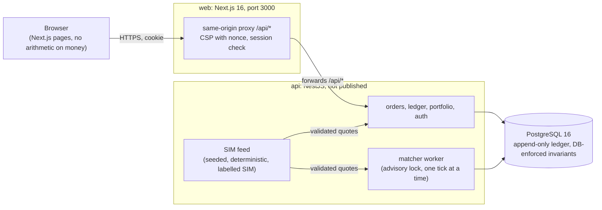
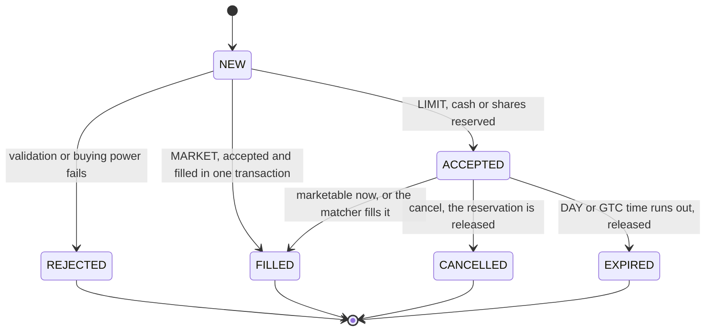
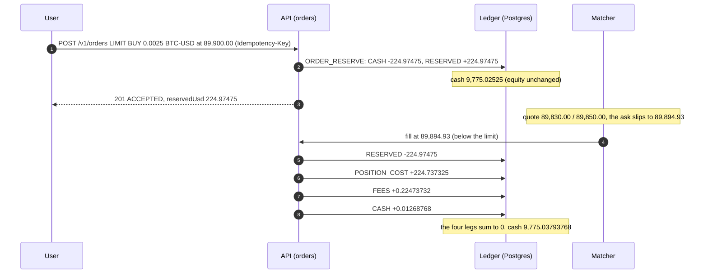
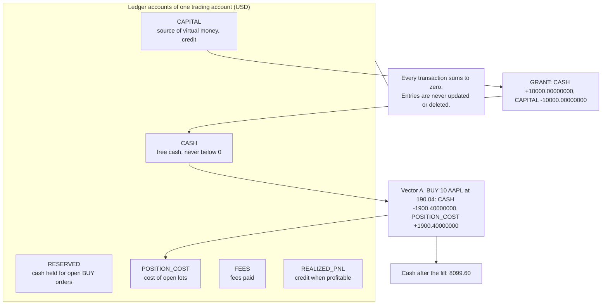
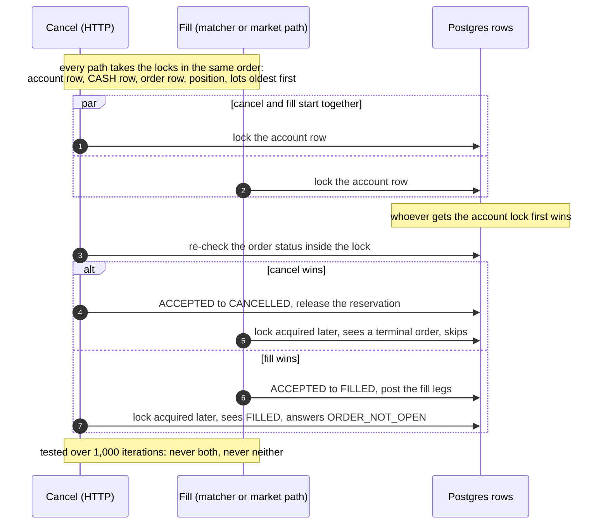

# Architecture diagrams

Generated by `node tools/build-diagram-doc.mjs` from the Mermaid sources in `docs/diagrams/`. Each source was rendered with `@mermaid-js/mermaid-cli@12.2.0` to prove it parses. `tools/diagrams.test.ts` checks that this file equals the sources and that every number in diagrams 3 and 4 equals a hard-coded golden-vector string in the code tests.

## 1. System context and containers

The browser only ever talks to the web app. The web app forwards `/api/*` to the API over the private network, and the API is the only thing that talks to Postgres. The matcher runs inside the API process. In the compose stack neither the API nor the database publishes a host port.

## 2. Order lifecycle (MARKET and LIMIT)

A MARKET order is created already FILLED or REJECTED and never changes. A LIMIT order is ACCEPTED, reserves cash (a BUY) or shares (a SELL) and then changes only by guarded transitions. Cancel is synchronous in the MVP (no CANCEL_REQUESTED state, D-93). Partial fills do not exist.

## 3. A limit BUY: accept (reserve), rest, matcher fill, ledger legs (golden vector E)

BTC-USD, 5 bps slippage, 10 bps commission, tick 0.01, grant 10,000. The numbers are the hard-coded strings of vector E in `packages/engine/src/limit-orders.test.ts`.

## 4. Ledger accounts and a double-entry example (golden vector A)

Vector A: BUY 10 AAPL, bid 189.95, ask 190.00, 2 bps slippage, fill 190.04, no fee. The numbers are the hard-coded strings in `packages/engine/src/engine.test.ts`.

## 5. Lock order and the cancel-versus-fill race

One account is serialised by its row lock, taken first on every path, so a cancel and a fill cannot interleave. See `docs/trading.md` (Locks) and the 1,000-iteration race test.

